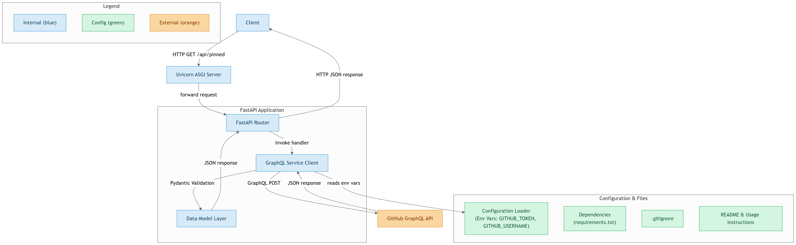

# GitHub Pinned Repositories API

A FastAPI application that creates an API endpoint to fetch pinned repositories from a GitHub profile using GitHub's GraphQL API, including a ready-to-use preview image for each repository.

## Features

- Fetches up to 6 pinned repositories
- Returns repository details including:
  - Name
  - Description
  - URL and live project URL (`homepageUrl`)
  - Star count
  - Fork count
  - Primary programming language
  - A preview image (`image`), resolved automatically (see [Preview images](#preview-images))
- Pin or unpin a repository on GitHub and the API picks it up, image included — no frontend changes needed
- Cached responses (10 minutes for repository data, 24 hours for live-site images), refreshed in the background so requests don't wait (see [Caching](#caching))
- Proper HTTP error codes

## Prerequisites

- Python 3.10+
- GitHub Personal Access Token
- Git

## Installation

1. Clone the repository:
```bash
git clone <repository-url>
cd <repository-name>
```

2. Install dependencies using requirements.txt:
```bash
pip install -r requirements.txt
```

3. Create a `.env` file in the root directory (see `.env.example`):
````plaintext
# filepath: .env
GITHUB_TOKEN=your_github_token
GITHUB_USERNAME=your_github_username
PUBLIC_BASE_URL=http://localhost:8000
````

## Usage

1. Start the FastAPI server:
```bash
uvicorn main:app --reload
```

2. Access the API endpoint:
```
GET http://localhost:8000/api/pinned
```

### Example Response

```json
[
  {
    "name": "repo-name",
    "description": "Repository description",
    "url": "https://github.com/username/repo-name",
    "homepageUrl": "https://repo-name.example.com",
    "stargazerCount": 42,
    "forkCount": 10,
    "languages": {
      "nodes": [
        {
          "name": "Python"
        }
      ]
    },
    "image": "https://octo-pinned-api.onrender.com/cached-images/repo-name-1a2b3c4d5e.webp"
  }
]
```

## Preview images

Each repository's `image` is resolved in this order — the first one found wins:

1. **Override file** — `static/projects/<repo-name>.<ext>` in this repository (`.webp`, `.png`, `.jpg`, `.jpeg`, `.avif`, `.gif`, `.svg`). The repo name is matched case-insensitively and the file is served at `/images/<file>`.
2. **Custom GitHub social preview** — the image uploaded under the repository's *Settings → Social preview*.
3. **Live site preview** — the `og:image` / `twitter:image` meta tag of the repository's `homepageUrl` (HTTPS images only).
4. **Live site screenshot** — taken via [microlink](https://microlink.io) when the site has no preview image.
5. **GitHub's automatic card** — the generated card with the repo name and stats.

Steps 3 and 4 are looked up once per site and cached for 24 hours (1 hour if nothing was found), so the screenshot service is only called a couple of times a day.

### Served by the API

Images from steps 2–5 are downloaded by the API, resized to 800px wide WebP (typically 5–30 KB) and served from memory at `/cached-images/<repo>-<hash>.webp` with a one-week browser cache. Browsers never hotlink GitHub's image hosts, which can be very slow or rate-limited (`429`).

- Each source image is re-downloaded once a day; the URL only changes when the image does.
- Downloads run in the background and never delay `/api/pinned`. Until an image is cached (e.g. right after a restart, or if a download fails), `image` is the original URL; failed downloads are retried on the next refresh.
- Override files (step 1) are served as-is from `/images/`.

### Adding an override

1. Add an image named after the repository, e.g. `static/projects/TastyTrails.webp`. A landscape image around 1200×630 works best.
2. Redeploy. Override files are read at startup, and their URL includes a version (`?v=`) so replacing a file busts browser caches.

## Caching

- Repository data is cached in memory for 10 minutes. When it expires, the next request gets the cached data right away and a refresh runs in the background.
- On startup the cache is warmed in the background (when `PUBLIC_BASE_URL` is set), so the first request after a deploy or restart doesn't wait. Without a warm cache, the first request waits for the fetch (~1–3s); concurrent requests share that single fetch.
- If a refresh fails, the cached data keeps being served and the refresh is retried after 60 seconds.
- Preview images are cached separately (see [Served by the API](#served-by-the-api)).
- The cache lives in memory, so it is emptied on every restart or redeploy.

## Error Handling

Errors return a non-2xx status with a JSON body:
```json
{
    "detail": "Error message"
}
```

- `500` — the server is missing `GITHUB_TOKEN` or `GITHUB_USERNAME`
- `502` — GitHub could not be reached or returned an error

If GitHub fails but a previous response is cached, the cached data is returned instead (see [Caching](#caching)).

## Configuration

- `GITHUB_TOKEN`: Your GitHub Personal Access Token
- `GITHUB_USERNAME`: GitHub username whose pinned repositories you want to fetch
- `PUBLIC_BASE_URL`: Public URL of this API (e.g. `https://octo-pinned-api.onrender.com`), used to build image URLs. Set it in production: behind a proxy the API may otherwise build `http://` URLs that browsers block on HTTPS sites.
- `ALLOWED_ORIGINS` (optional): Comma-separated list of origins allowed to call the API. Defaults to `*`.

## License

MIT License

## Contributing

1. Fork the repository
2. Create your feature branch
3. Commit your changes
4. Push to the branch
5. Create a new Pull Request


